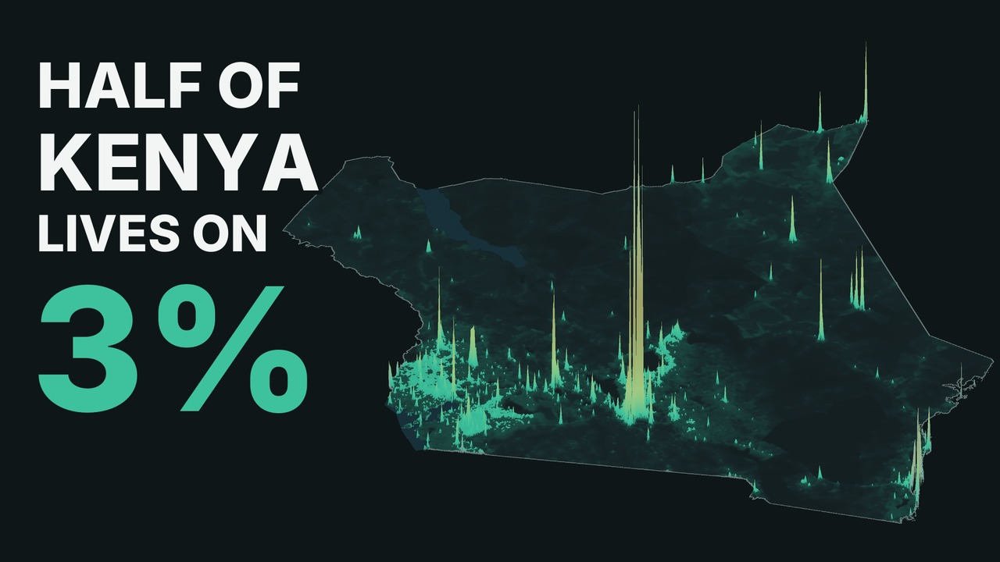

# Half of Kenya lives on 3% of the land

Code for the Geo Intelligence Lab video **"Half of Kenya Lives on 3%: the full map story"**.



Rank every ~1 km cell of Kenya from most crowded to emptiest, add up people and area as you go, and stop where the
people reach half. With WorldPop 2020 (1 km, UN-adjusted) that happens at **3.26%** of the land.

| Share of Kenyans | Share of the land it lives on |
|---|---|
| 10% | 0.04% |
| 25% | 0.48% |
| **50%** | **3.26%** |
| 75% | 9.77% |
| 90% | 22.66% |

The emptiest half of the land holds 2.03% of the people. Every cell in the densest half has more than 580 people per km².

## Run it

```bash
pip install -r requirements.txt
# download ken_ppp_2020_1km_Aggregated_UNadj.tif from
# https://data.worldpop.org/GIS/Population/Global_2000_2020_1km_UNadj/2020/KEN/
python concentration.py ken_ppp_2020_1km_Aggregated_UNadj.tif --blocks 1,10,50,100
```

## The four steps

1. **True cell area.** The grid is in degrees, and a degree cell shrinks away from the equator, so each row's area
   comes from its latitude: `R² · Δlon · (sin(top) − sin(bottom))`.
2. **Density** = people ÷ area.
3. **Sort** every cell, densest first (`np.argsort(-dens)`).
4. **Running totals** of people and area (`np.cumsum`), and the first index where people reach 0.5 (`np.searchsorted`).
   That curve is a Lorenz curve.

## Bigger units, different answer

`--blocks` sums cells into bigger blocks and runs the same steps again. The bigger the blocks, the more spread out
Kenya looks: in the video (equal-area km blocks clipped to Kenya) half the people sit on 3.3% of the land with 1 km
cells, 4.4% with 10 km blocks, 7.3% with 50 km and 9.0% with 100 km; with the 47 counties from the 2019 census, 7.6%.
This script's blocks are counted in grid cells on the degree grid, so its numbers for big blocks differ a little.
That is the modifiable areal unit problem.

## Limits

- WorldPop is a model. This product spreads people over every cell, even where nobody may live, which makes Kenya look
  *less* concentrated than it is.
- Its national total is adjusted to UN estimates and is higher than the 2019 census, so use the shares, not a headcount.
- The grid includes Kenya's parts of Lake Victoria and Lake Turkana (about 2% of the area, no people).

## Data and licences

- Population: WorldPop (www.worldpop.org), Global 2000-2020 1 km UN-adjusted, 2020. University of Southampton, CC BY 4.0.
- County borders (video only): geoBoundaries gbOpen KEN ADM1, public domain. County totals: KNBS 2019 Kenya Population and Housing Census, Vol. I.

Code: MIT. Made by John S Nkaiwatei, Geo Intelligence Lab · geointelligencelab.com · Free GIS Developer Starter Kit: geointelligencelab.com/toolkit
